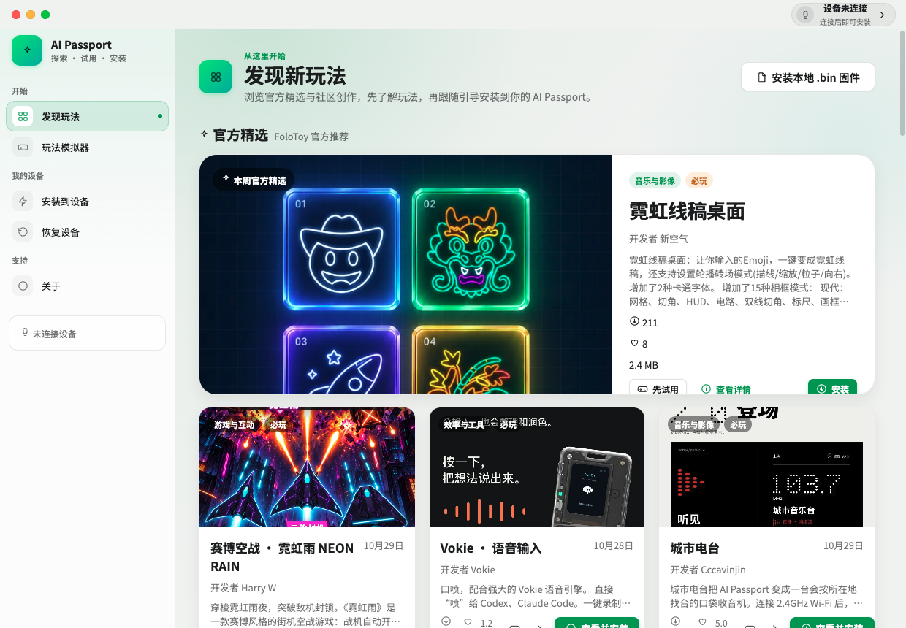
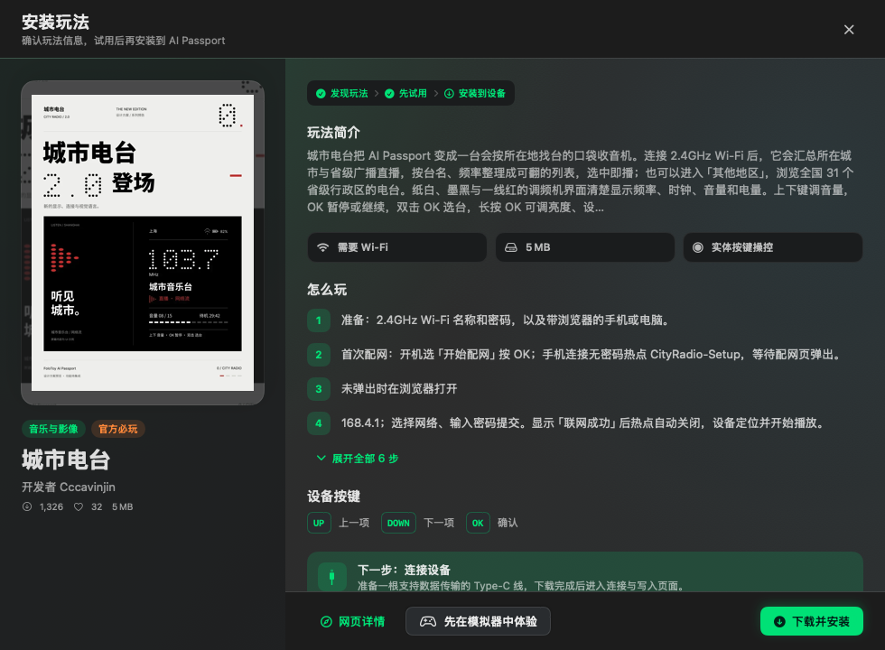
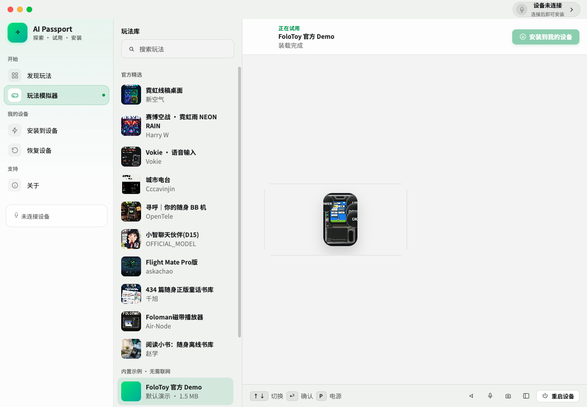
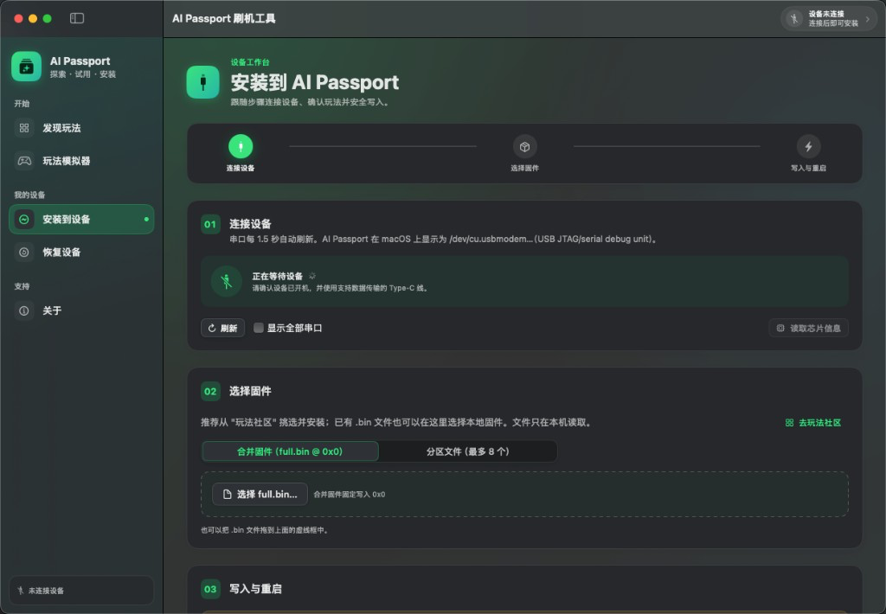
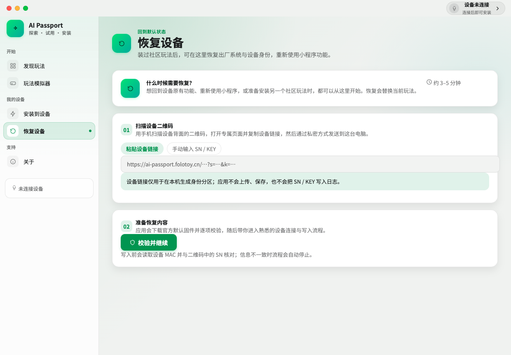

# AI Passport 刷机工具

给 [FoloToy AI Passport](https://ai-passport.folotoy.cn/)（ESP32-C3 · 8 MB Flash · USB Serial/JTAG）用的桌面刷机工具。

非官方工具。社区数据来自公开接口，不需要登录。

## 下载 v0.0.1

| 系统 | 安装包 |
| --- | --- |
| macOS 12 及以上，Apple 芯片和 Intel | [AIPassportFlasher-0.0.1-mac-universal.dmg](https://github.com/nexcode-ai/ai-passport-flasher/releases/download/v0.0.1/AIPassportFlasher-0.0.1-mac-universal.dmg) |
| Windows 10 / 11，64 位 | [AIPassportFlasher-0.0.1-windows-x64.zip](https://github.com/nexcode-ai/ai-passport-flasher/releases/download/v0.0.1/AIPassportFlasher-0.0.1-windows-x64.zip) |

安装包没有做代码签名。

- macOS：第一次打开时 Gatekeeper 会拦截。在访达里对应用按住 Control 再选择 "打开"，或到 "系统设置 → 隐私与安全性" 里允许。
- Windows：SmartScreen 可能提示 "Windows 已保护你的电脑"。选择 "更多信息"，再选择 "仍要运行"。解压 zip 后运行 `AIPassportFlasher.exe`。

## 界面

发现玩法。官方精选和社区目录来自实时数据，封面、作者、下载量和固件大小都是当前页面上的真实内容。



玩法详情。可以先看简介和操作说明，再下载安装，或先放进模拟器试用。



玩法模拟器。内置模拟器在本机打开社区玩法或示例固件，屏幕和按键可用，不占用 USB 设备。



安装到设备。连接串口、选择合并固件或分区，确认后写入并重启。



恢复设备。用设备二维码里的链接，或手动填写 SN / KEY，准备出厂固件后再进入写入。



## 能做什么

- **发现玩法**：浏览 [ai-passport.folotoy.cn](https://ai-passport.folotoy.cn/) 的官方精选和社区作品。可以搜索、按分类和标签筛选、按最新或热度排序，并继续向下加载。点 "安装" 才会下载固件，下载后核对文件大小、SHA-256 和镜像头 `0xE9`。
- **玩法模拟器**：内置 [FoloToy Passport Simulator](https://github.com/VOID001/FoloToy-Passport-Simulator)（MIT）。模拟器只监听 `127.0.0.1`，用来看屏幕、听声音、试按键。Wi-Fi 是虚拟网络，BLE、NFC 和电池不会被模拟。
- **安装到设备**：
  1. 连接设备。串口大约每 1.5 秒刷新一次。AI Passport 在 macOS 上通常是 `/dev/cu.usbmodem…`，在 Windows 上通常是 `COMx`（USB JTAG/serial debug unit，VID `303A` / PID `1001`）。可以只读芯片信息。
  2. 选择固件。一个合并固件 `full.bin` 写入 `0x0`，或最多 8 个分区。会检查 4 KB 对齐、区域重叠、8 MB 上限，以及 `0x0` 处的镜像头。
  3. 写入与重启。覆盖现有玩法前要勾选确认，并在对话框里再确认一次。进度和日志可以复制或保存。写完后硬件复位。
- **恢复设备**：粘贴二维码链接（`?s=SN&k=KEY`），或分开填写 SN / KEY。程序下载公开的默认固件并逐项校验，在本机生成 `cardid` 分区。写入前读取芯片 MAC，必须和 SN 一致，否则停止。SN / KEY 不上传、不保存、不写进日志。登记成其他型号的设备会被拒绝。

## 从源码运行

桌面版在 `desktop/`。

```bash
cd desktop
npm install
npm test
npm start
```

打包：

```bash
# macOS 通用 dmg。esptool 与 Node 已在仓库外的 Vendor/ 里
npm run pack:mac

# 在 macOS 上交叉打包 Windows zip。需要先准备 Windows 运行时
../scripts/fetch-windows-runtime.sh
npm run pack:win
```

`scripts/fetch-esptool.sh` 和 `scripts/fetch-node.sh` 负责 macOS 运行时，`scripts/fetch-windows-runtime.sh` 负责 Windows 的 `esptool.exe` 和 `node.exe`。这些二进制体积大，不放进 git。

仓库里还保留着原来的 SwiftUI macOS 工程，用 `./scripts/build-app.sh` 构建。发布包是上面的桌面版。

## 刷写时实际做了什么

内置的是 Espressif 官方 esptool v5.6.0，不需要本机安装 Python。社区玩法的写入参数与网页工具一致：

```text
esptool --chip esp32c3 --port <port> --baud <baud> --before default-reset --after hard-reset write-flash --flash-mode keep --flash-freq keep --flash-size keep <addr> <file> …
```

恢复出厂时改为 `--flash-mode dio --flash-freq 80m --flash-size 8MB`，并在核对 MAC 之后才写入。默认固件清单来自 `/assets/firmwares/ai-passport-default/manifest.json`：bootloader `0x0`、partition-table `0x8000`、trae_card `0x10000`、imgava `0x3FA000`，另外在 `0x356000` 写入 16 KB 的 `cardid` NVS 分区。

已下载的固件缓存在：

- macOS：`~/Library/Caches/AIPassportFlasher/firmware`
- Windows：`%LOCALAPPDATA%\AIPassportFlasher\firmware`

## 许可

本仓库的应用代码按仓库内许可使用。esptool 为 GPL-2.0-or-later，其 LICENSE 随安装包分发。玩法模拟器为 MIT。界面字体 Noto Sans SC 为 SIL Open Font License。
